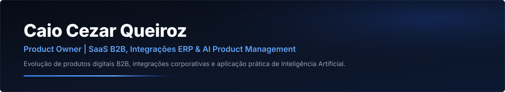

  

  &nbsp;
  &nbsp;
  &nbsp;
  &nbsp;
  

---

### Sobre mim

Product Owner com atuação na evolução de plataformas SaaS B2B de automação de força de vendas e gestão comercial. Construí minha trajetória dentro de operações reais de software corporativo, passando por suporte especializado e liderança técnica de implantações integradas a grandes ERPs antes de assumir a gestão de Produto. Essa bagagem me permite conectar descoberta de produto e visão de negócio a uma base técnica sólida em **SQL (Oracle, SQL Server, PostgreSQL), APIs REST e nuvem (AWS)**.

Atualmente aprofundo minha atuação em **AI Product Management**, com foco na especificação funcional de soluções com Inteligência Artificial, desenho de regras de negócio assistidas por LLMs e aplicação prática em produtos B2B.

- 🔭 **Atuação atual:** Product Owner na Landix Sistemas, conduzindo Product Discovery, priorização de backlog e definição de roadmap para soluções de força de vendas B2B.
- 🌱 **Foco em Produto & IA:** Product Discovery, especificações técnicas (PRDs), integração de IA generativa em fluxos B2B e validação de qualidade de modelos.
- 🎓 **Formação & Idiomas:** Engenheiro de Computação pela **UFU** e Inglês Avançado certificado (**TOEFL ITP C1**).
- 📫 **Contato:** [Portfólio (`caiocezarq.github.io`)](https://caiocezarq.github.io/) · [LinkedIn](https://www.linkedin.com/in/caiocezarq/) · caio.queiroz@outlook.com.br

---

### Stack & Ferramentas

**Produto & Gestão**  
    

**Dados, Integrações ERP & Engenharia**  
-1D4ED8?style=flat-square&logo=postgresql&logoColor=white)   

**Cloud & IA Aplicada**  
   

---

### Projetos & Portfólio em Destaque

- 🌐 **[caiocezarq.github.io](https://caiocezarq.github.io/)**: Portfólio profissional com estudos de caso de decisão de produto, trajetória em SaaS B2B, currículos em PT/EN e credenciais verificadas.
- 📋 **[product-prds](https://github.com/caiocezarq/product-prds)**: Especificações técnicas de produto (PRDs) voltadas para SaaS B2B, automação de força de vendas, regras de negócio de ERPs e aplicação prática de IA.
- 🤖 **[llm-comparison-benchmark](https://github.com/caiocezarq/llm-comparison-benchmark)**: Framework modular em Python para comparação objetiva entre modelos de linguagem (proprietários e open-weight), avaliando qualidade de resposta, benchmarks padronizados e geração de rankings normalizados.

---

### Certificações Verificadas

- 🏅 **[AI for Product Management](https://www.credly.com/badges/c7aa65c8-5c2d-4eb7-9376-982b42160b48)** · Pendo
- 🏅 **[Scrum Foundation Professional Certification (SFPC™)](https://www.credly.com/badges/67b080f3-25f2-41c7-b94a-610db9a120ba)** · CertiProf
- 🌎 **TOEFL ITP (Nível C1 · Inglês Avançado)** · ETS

Veja todas as credenciais verificadas em **[credly.com/users/caiocezarq](https://www.credly.com/users/caiocezarq)**.

---

<i>Aberto a conexões sobre Produto B2B, integrações, dados e IA aplicada.</i>

